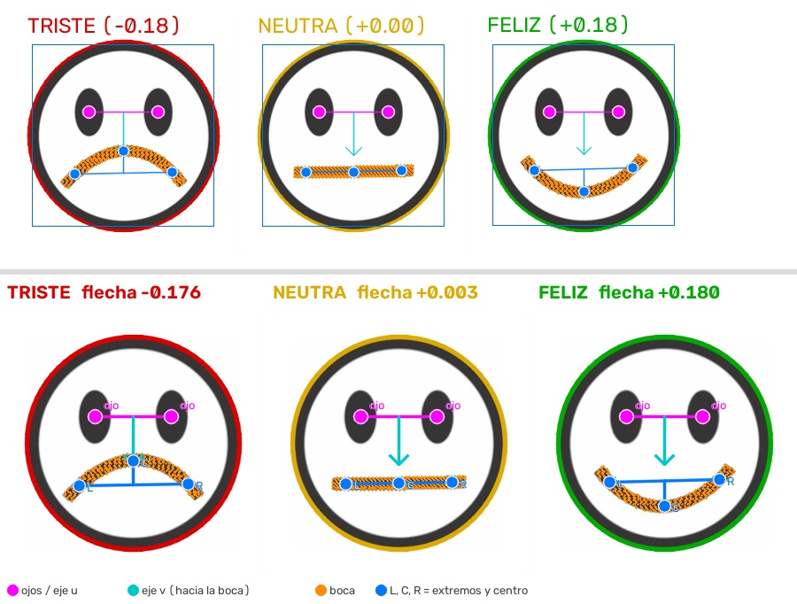

# Detector de víctimas smiley — RoboCupJunior Rescue Maze

Detecta las caras tipo *smiley* de la pista y dice si cada una está **feliz (UNHARMED)**, **neutra (STABLE)** o **triste (HARMED)**. Funciona aunque la cara esté **rotada** en cualquier ángulo.

Está pensado para caras con **contorno negro sobre fondo blanco** de 4 cm de diámetro, como pide el reglamento.



## Contenido

- [Instalación](#instalación)
- [Uso rápido](#uso-rápido)
- [Usarlo desde tu propio código](#usarlo-desde-tu-propio-código)
- [Cómo funciona](#cómo-funciona)
- [Calibración](#calibración)
- [Probar y medir](#probar-y-medir)
- [Limitaciones conocidas](#limitaciones-conocidas)
- [Siguiente paso: OpenMV](#siguiente-paso-openmv)

## Instalación

Requiere Python 3.9 o más nuevo. Probado en Mac (Apple Silicon) y Linux.

```bash
git clone <url-de-este-repositorio>
cd smiley_detector
python3 -m venv .venv
source .venv/bin/activate        # en Windows: .venv\Scripts\activate
pip install -r requirements.txt
```

## Uso rápido

```bash
# Una imagen: imprime el resultado y guarda la foto anotada en detectadas/
python -m smiley ejemplos/tres_caras.png
# ejemplos/tres_caras.png: TRISTE (-0.18), NEUTRA (+0.00), FELIZ (+0.18)
#     -> detectadas/tres_caras_TRISTE-NEUTRA-FELIZ.jpg
```

| Comando | Qué hace |
|---|---|
| `python -m smiley mis_fotos/` | Procesa una carpeta completa |
| `python -m smiley mis_fotos/ --save resultados/` | Guarda las fotos anotadas en otra carpeta |
| `python -m smiley mis_fotos/ --show` | Muestra cada imagen en una ventana (cualquier tecla = siguiente) |
| `python -m smiley mis_fotos/ --no-save` | Solo imprime, no guarda imágenes |
| `python -m smiley mis_fotos/ --save-all` | Guarda también las fotos sin caras (para ver qué se escapó) |
| `python -m smiley mis_fotos/ --json resultados.json` | Resultados en JSON con coordenadas de ojos y de la boca |
| `python -m smiley --camera 0` | Webcam en vivo; guarda un cuadro por segundo al detectar (`s` = guardar, `q` = salir) |

El número entre paréntesis es la **flecha** de la boca: positiva = sonrisa, negativa = tristeza, cerca de 0 = neutra.

### Qué trae la foto guardada

Cada foto con al menos una cara se guarda como `<nombre>_<RESULTADO>.jpg` (por ejemplo `foto_TRISTE.jpg` o `pared_FELIZ-NEUTRA.jpg`):

- **Arriba**, la imagen completa con el aro de cada cara (rojo = triste, amarillo = neutra, verde = feliz), el ROI (rectángulo azul) y el resultado.
- **Abajo**, un acercamiento de cada cara con:
  - **ojos** (magenta) y la línea entre ellos (**eje u**);
  - **eje v** (turquesa): de entre los ojos hacia la boca, es decir, el "abajo" de la cara aunque esté girada;
  - **boca** (naranja): los píxeles que se usaron;
  - **L, C, R** (azul): extremo izquierdo, centro y extremo derecho de la boca. La línea L–R es la cuerda y la línea hasta C es la **flecha**. Si C queda lejos de los ojos es sonrisa; si queda cerca, tristeza.
- Una leyenda de colores.

## Usarlo desde tu propio código

```python
import cv2
from smiley import Config, SmileyDetector

det = SmileyDetector(Config(threshold_mode="adaptive"))
img = cv2.imread("foto.jpg")
for d in det.detect(img):
    print(d.label, d.sagitta, d.ring.cx, d.ring.cy, d.ring.r)
```

## Cómo funciona

```
imagen
  └─ preprocess.py   binariza: se queda solo con lo oscuro
      └─ ring.py     busca aros: caja ~cuadrada, "huecos" (pocos píxeles), centro blanco
          └─ features.py  ROI del aro, quita el aro, busca blobs: 2 ojos + 1 boca
              └─ classify.py  eje u = ojo→ojo, eje v = hacia la boca
                              flecha = (v del centro de la boca − v de los extremos) / ancho
                              > +umbral → FELIZ   < −umbral → TRISTE   si no → NEUTRA
```

**Por qué funciona rotada:** los ojos definen hacia dónde está "arriba" en la cara. Sin ellos, una cara triste girada 180° se vería igual que una feliz.

### Estructura del proyecto

```
smiley_detector/
├── smiley/                 # el detector (paquete de Python)
│   ├── config.py           # todos los umbrales: aquí se calibra
│   ├── preprocess.py       # escala de grises, blur y binarización (Otsu, adaptativa o fija)
│   ├── ring.py             # encuentra los aros negros
│   ├── features.py         # ROI, ojos y boca, con filtros para descartar lo que no es cara
│   ├── classify.py         # la matemática de la flecha; Python puro, sin numpy (para la OpenMV)
│   ├── pipeline.py         # une todo: SmileyDetector.detect(imagen)
│   ├── draw.py             # dibuja aro, ROI, ojos, boca, ejes y puntos L, C, R
│   └── __main__.py         # la línea de comandos
├── tools/
│   ├── generate_synthetic.py   # genera caras sintéticas
│   ├── augment_from_image.py   # genera variaciones a partir de fotos reales
│   └── evaluate.py             # mide la precisión sobre imágenes etiquetadas
├── tests/test_detector.py  # pruebas automáticas
├── ejemplos/               # imágenes de prueba
└── docs/                   # imágenes del README
```

## Calibración

Todos los umbrales están en [`smiley/config.py`](smiley/config.py). Los más usados también se pueden cambiar desde la línea de comandos:

| Opción | Para qué |
|---|---|
| `--threshold-mode otsu` | Umbral global (el predeterminado es `adaptive`, que aguanta paredes grises y sombras) |
| `--threshold-mode fixed --fixed-threshold 90` | Umbral fijo de "negro" (0–255) |
| `--sagitta 0.07` | Umbral de la flecha para feliz/triste |
| `--min-diameter 30 --max-diameter 120` | Tamaño esperado de la cara en píxeles; reduce falsos positivos |
| `--all` | Muestra también aros donde no pudo leer la cara (para depurar) |

## Probar y medir

```bash
# Pruebas automáticas (imagen de ejemplo rotada 24 ángulos, sintéticas, falsos positivos)
python -m unittest discover tests -v

# Generar caras sintéticas (rotación, tamaño y posición aleatorios)
python tools/generate_synthetic.py --out sinteticas --n 300
# ...más difíciles: perspectiva, luz desigual, blur y ruido
python tools/generate_synthetic.py --out sinteticas_dificiles --n 300 --hard

# Medir precisión y ver el rango de la flecha por clase
python tools/evaluate.py sinteticas/ --errors errores/
```

### Generar más imágenes a partir de fotos propias

`tools/augment_from_image.py` toma las caras de una o varias fotos (las detecta solas) y crea variaciones: giradas, de distintos tamaños, con perspectiva, luz desigual, mancha de luz del LED, paredes de distintos tonos con uniones, desenfoque, ruido y compresión JPEG. El tamaño por defecto es 320×240 (QVGA, como la OpenMV).

```bash
python tools/augment_from_image.py ejemplos/tres_caras.png --out aumentadas --n 300 --preview
python tools/evaluate.py aumentadas/
```

`--preview` guarda además `_preview.jpg` con un mosaico de ejemplos. Si una foto trae una sola cara y quieres fijar su estado a mano, usa `--label HARMED` (o `STABLE`, `UNHARMED`).

### Con fotos reales

Nombra cada archivo empezando con su estado, por ejemplo `feliz_01.jpg`, `triste_07.jpg` o `neutra_03.jpg` (también acepta `UNHARMED_`, `HARMED_`, `STABLE_`), o pon las fotos en carpetas `feliz/`, `triste/` y `neutra/`. Luego:

```bash
python tools/evaluate.py fotos_reales/ --errors errores/
```

La sección **"Rango de la flecha por clase"** indica dónde poner `sagitta_threshold`: entre el máximo de la neutra y el mínimo de feliz y triste. Las fallas quedan anotadas en `errores/`.

## Limitaciones conocidas

- El aro tiene que verse **cerrado**. Si tiene un hueco (reflejo, mala impresión o cara cortada en el borde), no se detecta como cara.
- Si la boca **toca el aro**, se recorta la parte pegada y normalmente sigue funcionando, pero con mucho desenfoque puede fallar.
- Si la cara sale **cortada** en el borde de la imagen, no se detecta. En el robot conviene avanzar un poco y volver a mirar.
- Con mucha perspectiva (cámara muy de lado) la flecha se reduce. Mantén la cámara lo más perpendicular posible a la pared.
- Solo se ha probado con imágenes sintéticas, las imágenes de ejemplo y variaciones generadas a partir de ellas. **Falta validar con fotos reales tomadas con la cámara del robot.**

## Siguiente paso: OpenMV

`smiley/classify.py` ya es compatible con MicroPython. En la OpenMV, los pasos 1–3 se hacen con `img.find_blobs(...)` (umbral de oscuro, `roi=` del aro) y `img.get_pixel()` para los puntos de la boca. El resultado se manda por UART con el protocolo de `raspy.h` (`0x04` HARMED, `0x05` UNHARMED, `0x06` STABLE).
